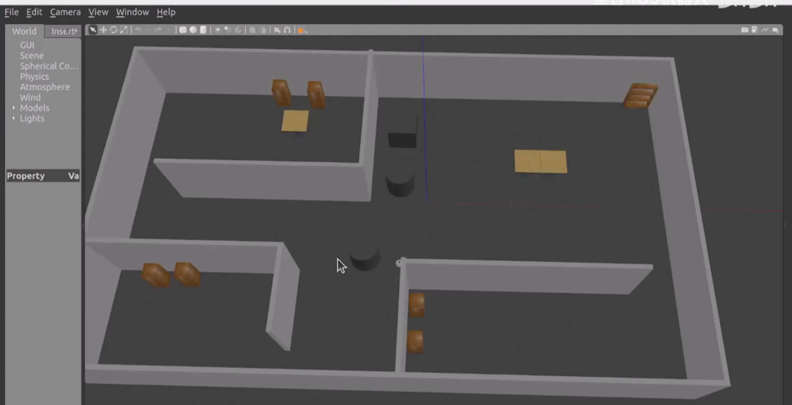
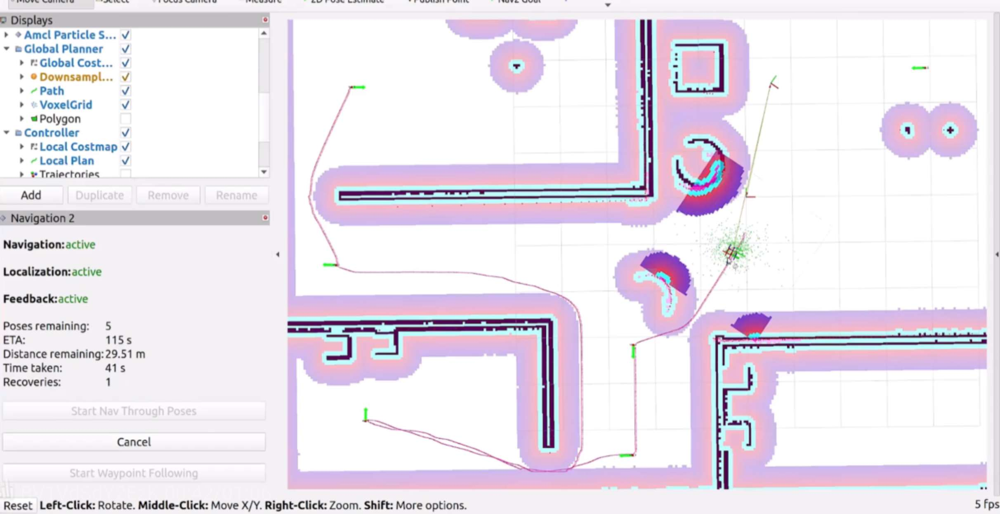
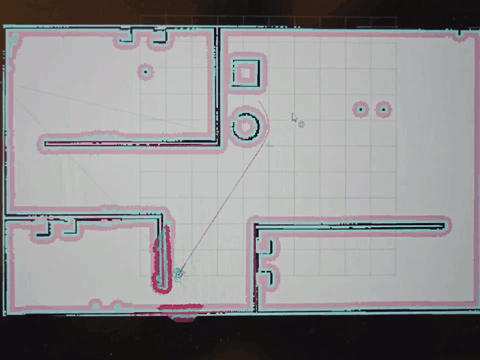

# ROS 2 Patrol Robot Simulation

基于 ROS 2 的移动机器人巡逻仿真项目，支持自主导航、多点巡逻、语音播报和到点拍照。

<p align="center">
  
  
</p>

## 项目功能

### 地图与自主导航

| 功能 | 可以做什么 |
| --- | --- |
| 地图构建 | 手动驾驶机器人探索房间，用激光雷达建立环境地图。 |
| 地图保存与加载 | 保存生成的地图，后续重新加载，也可以切换其他地图进行导航。 |
| 初始定位 | 设置机器人的起始位置和朝向，让机器人在地图中找到自己的位置。 |
| 当前位置查询 | 查看机器人在地图中的位置和朝向。 |
| 单目标导航 | 在 RViz 中选择目标，或通过程序发送目标，让机器人前往指定位置和朝向。 |
| 路径规划与避障 | 根据地图规划路线，结合激光探测到的障碍物调整行驶路径。 |
| 导航恢复 | 配置旋转、后退和等待等恢复动作，用于导航受阻时的恢复流程。 |

### 巡逻与现场记录

| 功能 | 可以做什么 |
| --- | --- |
| 单次多点导航 | 按顺序经过多个路点，完成一轮路线。 |
| 循环巡逻 | 依次访问预设巡逻点，完成一轮后继续重复，直到停止任务。 |
| 自定义巡逻路线 | 配置起始位姿，以及每个巡逻点的位置和到达朝向。 |
| 任务进度显示 | 查看导航剩余距离、当前路点编号和任务结果。 |
| 语音播报 | 播报初始化、准备出发、到达和图像记录等任务阶段，也可单独调用语音服务。 |
| 到点拍照 | 在巡逻点保存相机图像，用位置坐标命名照片，并指定保存目录。 |

### 观察与手动控制

| 功能 | 可以做什么 |
| --- | --- |
| 键盘遥控 | 手动控制机器人前进、后退、转向和停止，辅助探索与建图。 |
| 相机查看 | 查看彩色图像、深度图和点云，观察机器人周围环境。 |
| 传感器与状态查看 | 读取激光、IMU、里程计和轮关节状态，查看机器人位姿变化。 |
| 仿真可视化 | 在 Gazebo 中观察机器人运动，在 RViz 中查看地图、激光、路径和障碍物区域。 |

### 运行与验证

| 功能 | 可以做什么 |
| --- | --- |
| 组合或分开启动 | 一次启动仿真、导航和 RViz，也可以分别启动仿真与导航。 |
| 无界面运行 | 关闭图形窗口，在后台运行仿真导航。 |
| 自动导航检查 | 检查传感器与导航状态，发送目标，并保存到达结果、终点误差和运动记录。 |

各功能的操作步骤和扩展依赖见 [使用文档](docs/USAGE.md)。循环巡逻、语音与拍照的完整流程仍待联调。

## 演示视频

[](Navigation.mp4)

[观看完整视频](Navigation.mp4)

## 首次使用

先准备 Conda 和构建工具，详见 [安装说明](docs/USAGE.md)。然后下载项目并创建环境：

```bash
git clone https://github.com/qiwanggoing/ROS2_PARTOL_ROBOT.git
cd ROS2_PARTOL_ROBOT
conda env create --file environment.navigation.yml
conda activate ros2_patrol
```

按 [安装说明](docs/USAGE.md) 将 `scripts/navigation.sh` 顶部的 `conda_root` 和 `patrol_env` 改为自己的安装路径，然后启动：

```bash
bash scripts/navigation.sh build
bash scripts/navigation.sh demo
```

在 RViz 中用 **2D Pose Estimate** 设置初始位置，再用 **Nav2 Goal** 选择目标。

详细操作与环境配置见 [使用文档](docs/USAGE.md)。

项目基于 [fishros / FishBot](https://github.com/fishros) 教育材料扩展。
